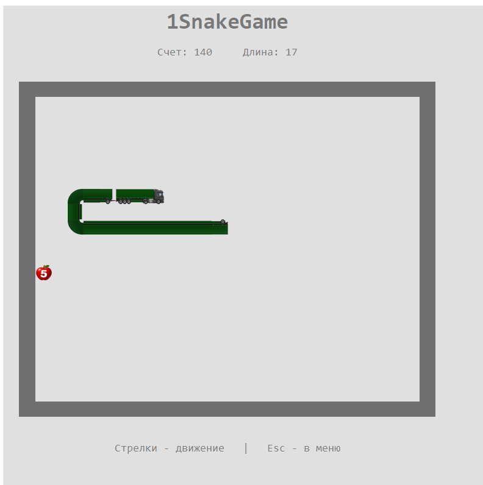

# 1SnakeGame

**Змейка на колёсах, написанная на чистом 1С.**

Вместо змейки — тягач с полуприцепом, за которым растёт гигантский зелёный прицеп. Собирайте яблоки, набирайте очки и старайтесь не врезаться в стены или собственный хвост.

## Возможности

- Одна внешняя обработка `1SnakeGame.epf`, без БСП и установки расширения конфигурации.
- Вся игровая логика на встроенном языке 1С; интерфейс — табличный документ со встроенными картинками.
- Главное меню с кнопками «начать игру» и «посмотреть статистику».
- Общая для пользователей текущей базы таблица десяти лучших результатов.

## Запуск

1. Скачайте [1SnakeGame.epf из последнего релиза](https://github.com/SmaginAV/1SnakeGame/releases/latest/download/1SnakeGame.epf). [Описание релиза и файлы](https://github.com/SmaginAV/1SnakeGame/releases/latest).
2. Запустите информационную базу в тонком или толстом клиенте с управляемыми формами.
3. Откройте файл обработки штатной командой открытия файла в 1С.
4. Нажмите «начать игру».

## Управление и правила

| Клавиша | Действие |
|---|---|
| ↑ ↓ ← → | Изменить направление движения |
| Esc | Вернуться в меню; активная партия отменяется без записи результата |

Начальный автопоезд занимает три клетки. Каждое яблоко добавляет один сегмент к сплошному прицепу и **10 очков**. 

Разворот в противоположную сторону запрещён. Столкновение со стеной или телом завершает партию. При заполнении поля игра заканчивается победой. Размер поля — 24 × 20 клеток.

## Рекорды

Хранятся только **10 лучших партий текущей базы**. Один игрок может занимать несколько мест. Сортировка: очки по убыванию, время завершения по возрастанию, затем идентификатор партии.

После сохранения партии или открытия статистики обработка удаляет свои результаты ниже десятого места, включая лишнюю историю прежней версии. Результат, не вошедший в топ-10, не остаётся в хранилище. Рейтинги разных баз независимы.

## Совместимость и права

Целевая платформа — **1С:Предприятие 8.3.27 и выше**, тонкий и толстый клиент, управляемые формы. Фактические проверки проводились на **8.3.27.2074**. Веб-клиент и обычные формы в текущую поставку не входят.

## Исходники

[ИграЗмейка.xml](ИграЗмейка.xml) и каталог `ИграЗмейка/` содержат XML-исходники внешней обработки, модуль формы на BSL и встроенные графические ресурсы. Для игры достаточно готового EPF; отдельные картинки устанавливать не требуется.
